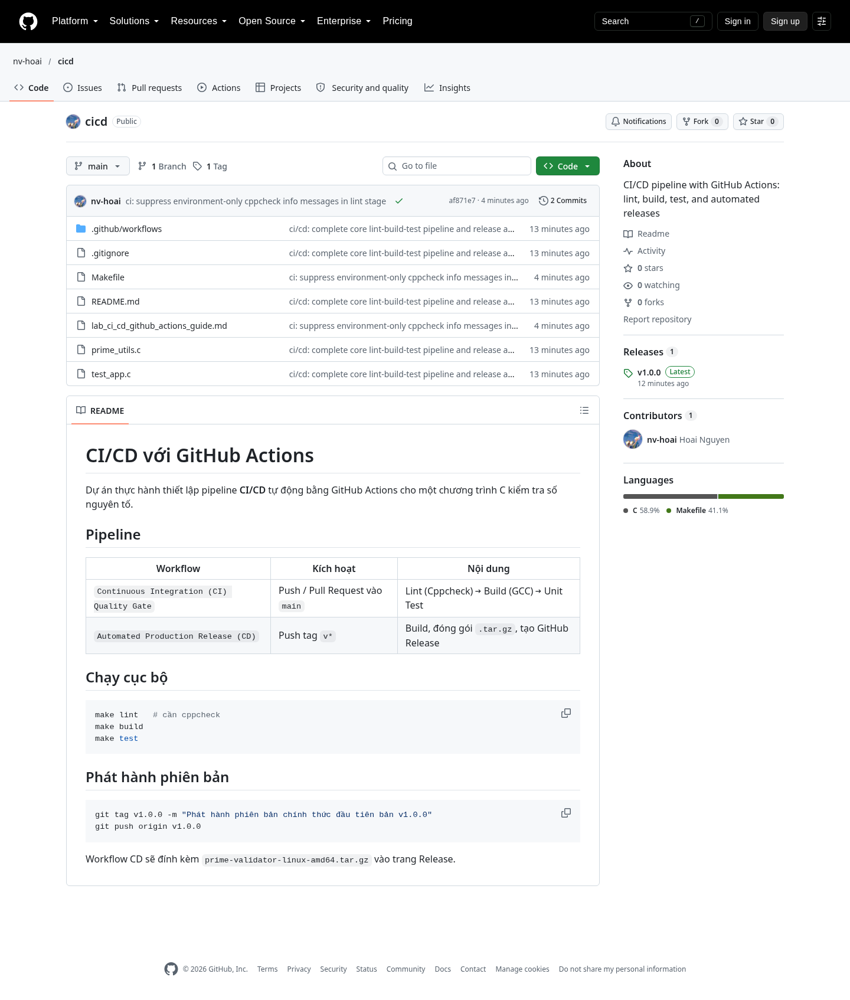
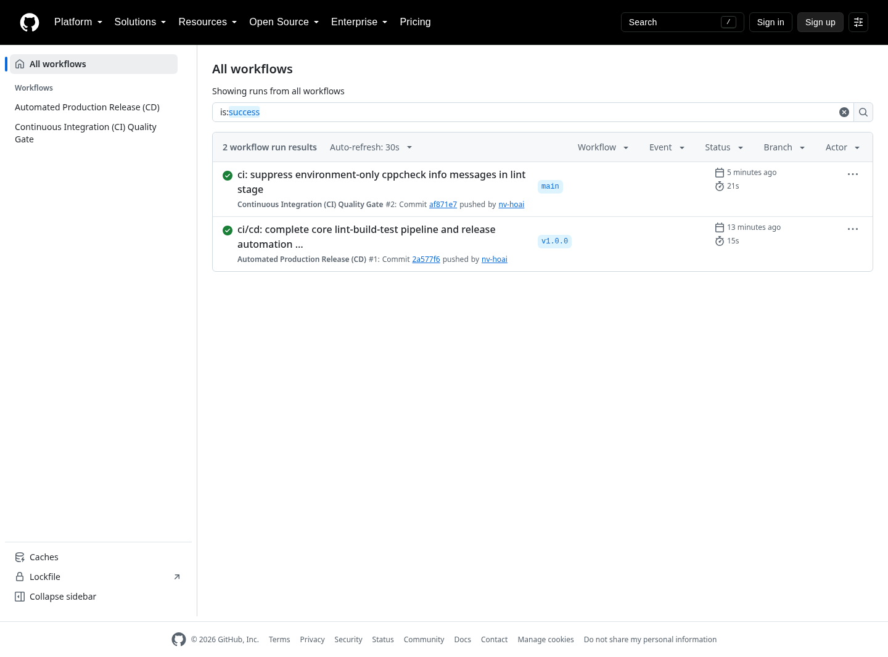
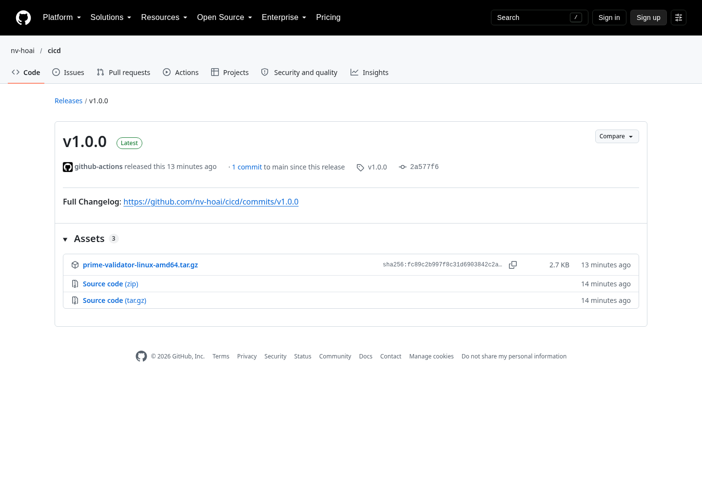
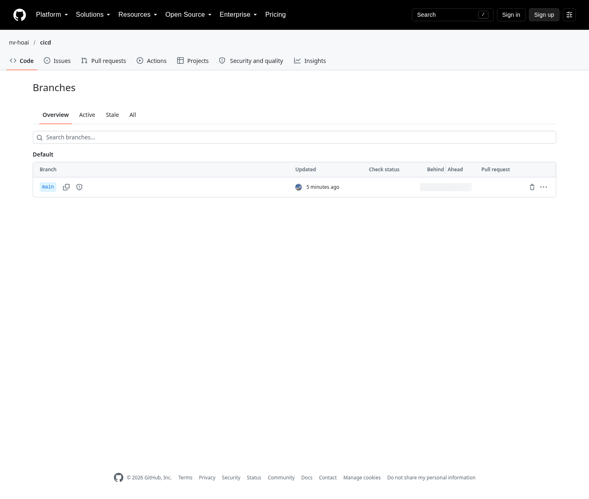

# Báo cáo thực hành: CI/CD với GitHub Actions

**Người thực hiện:** Nguyễn Văn Hoài - 102230241 · **Ngày:** 19/10/2026  
**Repository:** https://github.com/nv-hoai/cicd  
**Môi trường:** Fedora Linux 44 (WSL), GCC 16.1.1, GNU Make, Cppcheck 2.22.0; runner `ubuntu-latest`.

---

## 1. Kết quả

| Hạng mục | Kết quả |
| --- | --- |
| Repository public | https://github.com/nv-hoai/cicd |
| CI (Lint → Build → Test) | Thành công, lần chạy gần nhất 21 giây |
| CD (theo tag `v*`) | Thành công, tạo Release `v1.0.0` |
| Asset phát hành | `prime-validator-linux-amd64.tar.gz` |
| Bảo vệ nhánh `main` | Bắt buộc check `continuous-integration` |



*Repository với mã nguồn và hai workflow.*



*CI và CD đều chạy thành công.*



*Release kèm file nén cho người dùng tải về.*



*Nhánh `main` hiển thị biểu tượng bảo vệ.*

---

## 2. Tóm tắt các bước

1. Tạo project C gồm `prime_utils.c` (hàm `is_prime`), `test_app.c` (unit test, có edge case `INT_MAX`), `Makefile` với các target `lint`/`build`/`test`/`clean`.
2. Viết `.github/workflows/ci.yml`: chạy khi push hoặc pull request vào `main`, cài `gcc`/`make`/`cppcheck`, rồi chạy lần lượt ba giai đoạn Lint, Build, Test.
3. Viết `.github/workflows/release.yml`: chạy khi push tag `v*`, build bản production, nén thành `.tar.gz` và đăng lên GitHub Release bằng `softprops/action-gh-release@v2`.
4. Tạo repository public bằng `gh repo create`, push code, đánh tag `v1.0.0` và push tag.
5. Bật branch protection cho `main`, yêu cầu status check `continuous-integration` phải pass trước khi merge.

---

## 3. Sự cố và xử lý

Lần chạy CI đầu tiên thất bại ở bước Lint. Nguyên nhân là Cppcheck phát sinh các thông báo mức `information` về môi trường (`missingIncludeSystem`, `checkersReport`), và `--error-exitcode=1` khiến chúng bị coi là lỗi. Mã nguồn không có lỗi thực sự.

Cách xử lý: bỏ qua hai loại thông báo trên, vẫn giữ `--enable=all` để bắt lỗi thật.

```makefile
lint:
	cppcheck --enable=all --suppress=missingIncludeSystem --suppress=checkersReport --error-exitcode=1 prime_utils.c test_app.c
```

Sau khi push bản sửa, CI chuyển sang trạng thái thành công.

---

## 4. Kiểm chứng

- `make lint`, `make build`, `make test` chạy pass ở máy.
- Tải asset từ Release, giải nén và chạy thử: in đúng thông báo `TẤT CẢ CÁC BÀI UNIT TEST ĐÃ VƯỢT QUA SẠCH LỖI!`, mã thoát 0.
- API xác nhận branch protection vẫn bắt buộc check `continuous-integration`.

Phần mô phỏng làm hỏng `is_prime` để thấy pipeline đỏ không thực hiện trên `main`, nhằm giữ repository ở trạng thái sạch.
