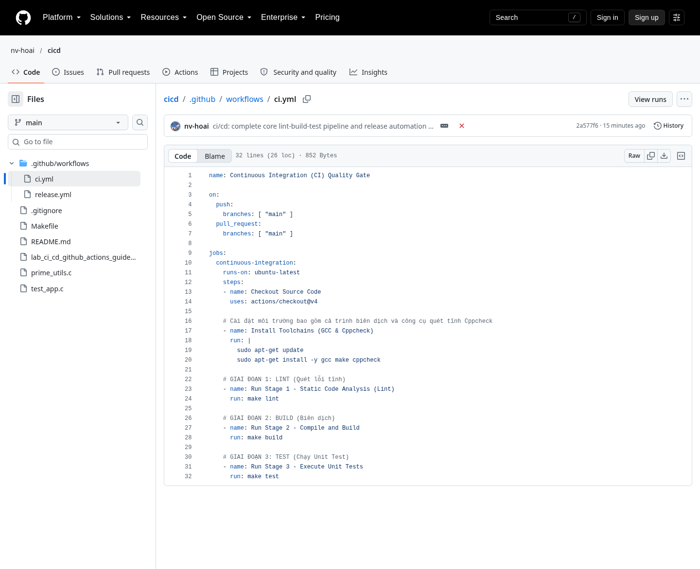
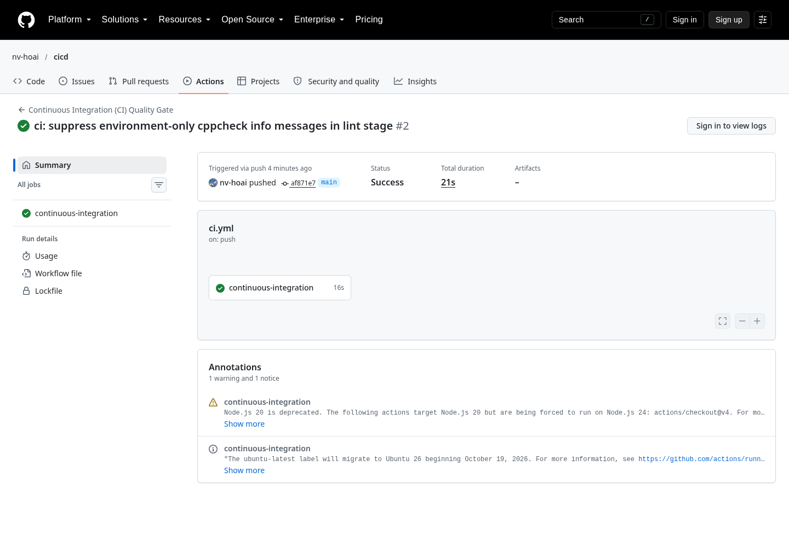

# Báo cáo thực hành: CI/CD với GitHub Actions

**Người thực hiện:** nv-hoai  
**Ngày hoàn thành:** 19/10/2026  
**Repository:** https://github.com/nv-hoai/cicd  
**Môi trường:** Fedora Linux 44 (WSL), GCC 16.1.1, GNU Make, Cppcheck 2.22.0; runner GitHub Actions `ubuntu-latest`.

Mình làm bài này để trả lời một câu hỏi khá thực tế: làm sao để mỗi lần đẩy code lên, mọi bước kiểm tra tự chạy mà không phải nhớ từng lệnh? Kết quả là một repository công khai với hai workflow: một cái lo chất lượng code, một cái lo phát hành phiên bản. Dưới đây là quá trình mình đã làm, kèm ảnh chụp từng bước.

---

## 1. Mục tiêu

Chương trình mình chọn để luyện tập là một hàm C kiểm tra số nguyên tố. Nghe có vẻ đơn giản, nhưng nó đủ để đi qua cả ba giai đoạn của một pipeline: quét mã tĩnh, biên dịch và chạy test.

Mình đặt ra ba việc cụ thể:

- Mỗi lần push hoặc mở pull request vào `main`, GitHub tự chạy **Lint → Build → Test**.
- Khi đẩy một tag phiên bản `v*`, GitHub tự build, đóng gói và tạo Release kèm file tải về.
- Nhánh `main` phải bị khóa bằng status check, để code đỏ không thể merge.

---

## 2. Kết quả

Sau khi hoàn tất, pipeline chạy đúng như mong đợi: lần chạy CI gần nhất mất 21 giây và kết thúc màu xanh, còn release `v1.0.0` đã có sẵn file nén cho người dùng tải về.

| Hạng mục | Kết quả |
| --- | --- |
| Repository | https://github.com/nv-hoai/cicd (public) |
| Workflow CI | `.github/workflows/ci.yml` — Lint, Build, Test |
| Workflow CD | `.github/workflows/release.yml` — phát hành khi có tag `v*` |
| Lần chạy CI gần nhất | Thành công, 21 giây |
| Release | `v1.0.0`, kèm `prime-validator-linux-amd64.tar.gz` |
| Bảo vệ nhánh `main` | Bắt buộc check `continuous-integration` |

---

## 3. Quá trình thực hiện

### 3.1. Chuẩn bị mã nguồn

Trước khi động đến GitHub Actions, mình dựng một project C nhỏ ngay trên máy. Có bốn file chính:

| File | Nội dung |
| --- | --- |
| `prime_utils.c` | Hàm `is_prime(int n)` |
| `test_app.c` | Unit test bằng `assert()` |
| `Makefile` | Các lệnh `build`, `test`, `lint`, `clean` |
| `.gitignore` | Bỏ qua `validator` và `*.tar.gz` |

Điều mình chú ý nhất là phần test. Ngoài các số nhỏ như 1, 2, 3, 4, 5, mình giữ lại bài kiểm tra với `INT_MAX` (2147483647) — một số nguyên tố nổi tiếng. Bài này buộc hàm phải xử lý đúng giới hạn của `int`, và cũng là chỗ dễ lộ lỗi tràn số nếu ai đó viết vòng lặp bằng `i * i`.

Trước khi đẩy lên GitHub, mình chạy thử toàn bộ ở máy:

```bash
make lint
make build
make test
```

Kết quả:

```text
gcc -Wall -Wextra -O3 prime_utils.c test_app.c -o validator
./validator
TẤT CẢ CÁC BÀI UNIT TEST ĐÃ VƯỢT QUA SẠCH LỖI!
```

### 3.2. Viết workflow CI

Workflow CI nằm ở `.github/workflows/ci.yml`. Mình cho nó chạy khi có push hoặc pull request vào `main`, với một job duy nhất tên là `continuous-integration`.

Lý do mình đặt tên job như vậy là để lát nữa dùng lại chính cái tên này khi cấu hình bảo vệ nhánh. GitHub sẽ tìm đúng status check theo tên job, nên đặt từ đầu cho khỏi phải sửa về sau.

Các bước trong job:

1. Checkout mã nguồn.
2. Cài `gcc`, `make` và `cppcheck`.
3. Chạy `make lint`.
4. Chạy `make build`.
5. Chạy `make test`.



*Hình 1: Workflow `ci.yml` với ba giai đoạn Lint, Build và Test.*

### 3.3. Viết workflow phát hành

Nếu CI trả lời câu hỏi "code có ổn không", thì `release.yml` trả lời câu hỏi "làm sao đưa bản chạy được đến người dùng". Workflow này chỉ chạy khi mình đẩy một tag bắt đầu bằng `v`, ví dụ `v1.0.0`.

Bên trong, mình cấp quyền `contents: write` để GitHub Actions được phép tạo Release. Các bước gồm: checkout toàn bộ lịch sử Git, cài trình biên dịch, build bản production, nén `validator` thành `prime-validator-linux-amd64.tar.gz`, rồi dùng `softprops/action-gh-release@v2` để đăng file lên trang Release và tự sinh release notes.

Mình để `fetch-depth: 0` vì action tạo release notes cần đọc lịch sử commit, chứ không chỉ commit gần nhất.

### 3.4. Đưa lên GitHub và chạy thử

Mình tạo repository bằng GitHub CLI, đẩy code lên, rồi đánh tag:

```bash
git init -b main
git add .
git commit -m "ci/cd: complete core lint-build-test pipeline and release automation workflow"

gh repo create nv-hoai/cicd --public --source=. --remote=origin --push

git tag v1.0.0 -m "Phát hành phiên bản chính thức đầu tiên bản v1.0.0"
git push origin v1.0.0
```

Ngay sau khi push, tab Actions có hai lần chạy: CI cho nhánh `main` và CD cho tag `v1.0.0`. Cả hai đều xanh.


*Hình 2: Repository public với mã nguồn, workflow và README.*


*Hình 3: Tab Actions sau khi lọc các lần chạy thành công — thấy rõ cả CI và CD.*



*Hình 4: Lần chạy CI gần nhất kết thúc với trạng thái Success.*


*Hình 5: Release `v1.0.0` với file `prime-validator-linux-amd64.tar.gz` đính kèm.*

### 3.5. Khóa nhánh `main`

Mình nghĩ phần này mới là chỗ làm cho CI có ý nghĩa. Nếu ai cũng có thể merge code đỏ vào `main` thì pipeline chỉ để xem cho vui.

Mình bật branch protection cho `main` và yêu cầu status check `continuous-integration` phải pass trước khi merge. Đồng thời tắt force push và xóa nhánh. Mình không bật `enforce_admins`, nên tài khoản chủ repo vẫn push trực tiếp được khi cần.

Cấu hình được áp dụng qua API:

```bash
gh api repos/nv-hoai/cicd/branches/main/protection -X PUT --input - <<'EOF'
{
  "required_status_checks": {
    "strict": true,
    "contexts": ["continuous-integration"]
  },
  "enforce_admins": false,
  "required_pull_request_reviews": null,
  "restrictions": null
}
EOF
```


*Hình 6: Nhánh `main` hiển thị biểu tượng khiên trên trang Branches.*

---

## 4. Chỗ vấp phải: lần chạy CI đầu tiên màu đỏ

Lần push đầu tiên, mình mở tab Actions và thấy CI dừng ngay ở bước Lint. Log in ra như sau:

```text
cppcheck --enable=all --error-exitcode=1 prime_utils.c test_app.c
prime_utils.c:1:0: information: Include file: <stdio.h> not found ... [missingIncludeSystem]
test_app.c:1:0: information: Include file: <stdio.h> not found ... [missingIncludeSystem]
test_app.c:2:0: information: Include file: <assert.h> not found ... [missingIncludeSystem]
nofile:0:0: information: Active checkers: ... [checkersReport]
make: *** [Makefile:14: lint] Error 1
```

Thoạt nhìn thì tưởng code có lỗi, nhưng đọc kỹ thì tất cả các dòng đều là mức `information`, và nội dung chỉ nói về môi trường: Cppcheck không tìm thấy header chuẩn, cộng thêm một dòng báo cáo checker. Không có lỗi nào trong `prime_utils.c` hay `test_app.c`.

Vấn đề nằm ở chỗ `--error-exitcode=1` khiến Cppcheck trả mã lỗi cho cả những thông báo này. Trên máy mình dùng Cppcheck 2.22, hành vi đó lặp lại được, nên mình sửa bằng cách bỏ qua hai loại thông báo chỉ mang tính môi trường, vẫn giữ `--enable=all` để bắt lỗi thật:

```makefile
lint:
	cppcheck --enable=all --suppress=missingIncludeSystem --suppress=checkersReport --error-exitcode=1 prime_utils.c test_app.c
```

Sau khi commit bản sửa và push, CI xanh trở lại. Mình cũng cập nhật lại đoạn lệnh này trong file hướng dẫn để lần sau không ai gặp lại lỗi cũ.

Còn phần cố ý làm hỏng `is_prime` để xem pipeline chuyển đỏ thì mình không làm trên `main`, vì muốn giữ repository ở trạng thái sạch. Nếu cần demo, chỉ cần tạo một nhánh hoặc PR riêng là được.

---

## 5. Kiểm tra lại lần cuối

Mình không chỉ nhìn màu xanh trên web rồi kết luận. Mình kiểm tra thêm vài thứ:

- Chạy `make lint`, `make build`, `make test` ở máy — tất cả đều pass.
- Tải file `prime-validator-linux-amd64.tar.gz` từ trang Release, giải nén và chạy thử. Chương trình in đúng dòng `TẤT CẢ CÁC BÀI UNIT TEST ĐÃ VƯỢT QUA SẠCH LỖI!` và trả về mã thoát 0.
- Gọi API kiểm tra branch protection — status check bắt buộc vẫn là `continuous-integration`.

Như vậy là cả phần code, phần pipeline và phần phát hành đều đã được kiểm chứng, không chỉ dừng ở việc "trông có vẻ ổn".

---

## 6. Mình rút ra được gì

Điều mình thấy rõ nhất sau bài này là một pipeline chỉ đáng tin khi nó thực sự fail đúng lúc. Lần CI đỏ đầu tiên không phải do code sai, mà do công cụ lint được cấu hình quá nhạy với môi trường. Nếu không đọc log, rất dễ sửa code theo hướng sai hoặc tệ hơn là bỏ qua cảnh báo.

Mình cũng thấy việc tách CI và CD thành hai workflow riêng khá gọn. CI chạy theo nhánh, còn CD chạy theo tag. Nhờ vậy, việc phát hành là một hành động có chủ đích, không xảy ra lẫn với những lần push thông thường.

Cuối cùng, branch protection là bước nhỏ nhưng quan trọng. Nó biến CI từ một bảng thông báo thành một chốt chặn thật sự trước khi code vào `main`.

---

**Repository:** https://github.com/nv-hoai/cicd  
**Release:** https://github.com/nv-hoai/cicd/releases/tag/v1.0.0
